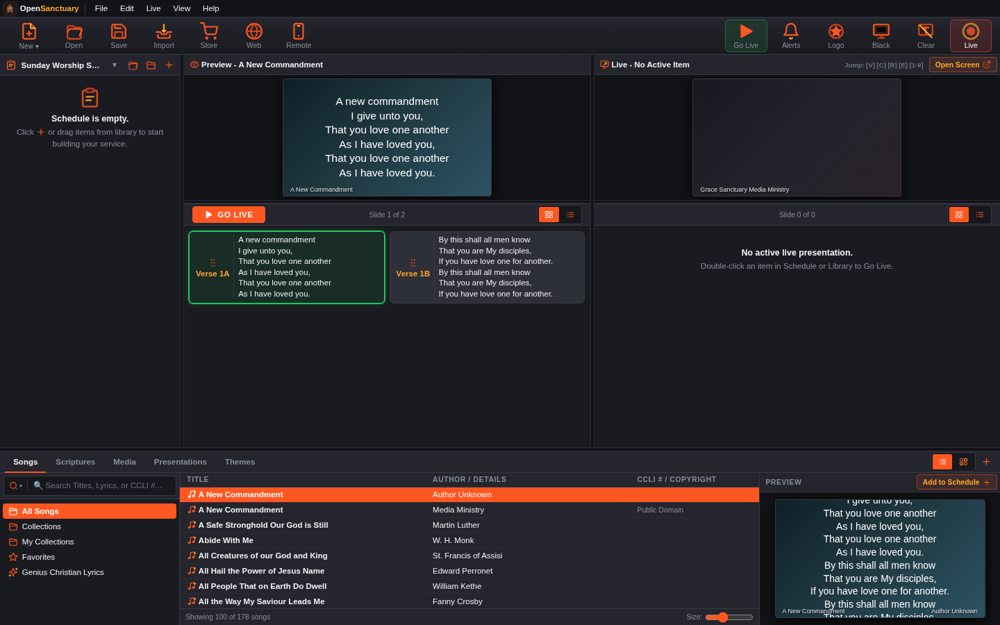
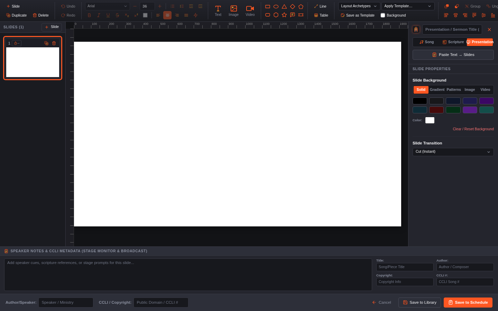
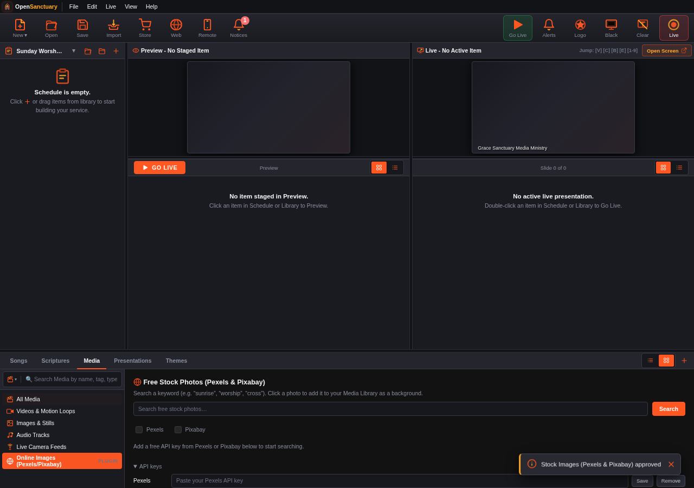

# OpenSanctuary

_Last edited: 2026-10-22_

A next-generation church presentation engine — the software that drives the
screens during a church service (lyrics, scripture, announcements, video)
— written in Rust with a TypeScript web-based control UI.

## Why this exists

Existing church presentation tools are mostly older Windows-only desktop
apps (EasyWorship, ProPresenter) with per-seat licensing, no real
multi-display story, and formats that don't talk to each other. OpenSanctuary is built around a different set of assumptions:

- **A browser is the client.** The operator console, the Live/Stage/Remote
  output screens, and the mobile remote control are all just web pages
  served over the LAN. No per-machine install for anything but the one
  server.
- **Your existing library should still work.** Real import support for
  EasyWorship (`.ewsx`, and EasyWorship 5 `.ews` schedules), OpenLP (`.sqlite`/`.osj`/`.osz`), FreeShow
  (`.show`/`.project`), PowerPoint (`.pptx`), and OpenDocument Presentation
  (`.odp`) — moving to OpenSanctuary shouldn't mean rebuilding years of songs
  and slides by hand. `.odp` also exports, so a presentation can leave again.
  OpenSanctuary also has its own files (`.ossong`, `.ospres`, `.osservice`,
  `.osbible`) that carry a song, presentation, service or Bible together with
  its pictures, videos and music — see [docs/file-formats.md](docs/file-formats.md).
- **Cross-platform, not Windows-only.** One Rust binary; Linux, Windows, and (maybe eventually) macOS from the same codebase.
- **No per-seat licensing.** MIT-licensed. Run it on as many machines as
  your church has.

Status: **beta** (currently beta 3, released as `v0.3.0`). No 1.0 yet. The
core engine, multi-display output, most import paths, CCLI reporting, and
reverse-proxy tunneling are built and used for real — each doc under
`docs/` says plainly whether what it describes is implemented or still a
design.

## Screenshots

The operator console (library, schedule, preview and live panes) and the slide builder:





## Features

**Live production**
- A scheduling engine for songs, scripture, media, and free-form slides,
  with live/staged state (what's on screen vs. queued up next) kept in
  sync over WebSocket across every connected display.
- A slide editor with text styling, backgrounds, image/video elements,
  autofit text, and themes.
- Blackout, clear-text, and logo-override controls for the live output.
- Video/audio playback with loop control. Online stock photos (Pexels/Pixabay)
  for backgrounds come from a bundled plugin you approve in Settings > Plugins.

**Displays & remote control**
- **Live Output** (front-of-house) and **Stage Foldback** (confidence
  monitor) as separate pages, each independently themeable.
- **Remote Control** — a mobile-friendly page to drive the service from a
  phone or tablet, paired via QR code.
- **Android TV client** (`apps/android-tv`) for permanent displays. The
  console installs it over ADB and makes it the TV's home app (the stock
  launcher is switched off, and can be switched back on from the console),
  so the TV boots straight into OpenSanctuary — no Play Store listing, no
  typing an IP address on a remote. Pairing is always a phone scanning the
  QR code on the TV.
- **Roku channel** (`apps/roku`) also works as a basic client today —
  type the server's IP into its Settings screen once. It doesn't have
  Android TV's no-typing sideload-and-pair flow yet; that part of Roku
  support is still just a documented design (`src/discovery.rs`).
- Any screen capture tool (OBS Browser Source, etc.) can broadcast the
  Live Output page directly — see `docs/BROADCASTING.md`.

**Content & import**
- Real importers for EasyWorship, OpenLP, FreeShow, PowerPoint, and
  OpenDocument Presentation (`.odp`) — not just "read the text," but slides,
  backgrounds, and arrangements. YMMV. `.odp` round-trips: export a
  presentation back out, e.g. to hand to someone using LibreOffice Impress.
- Bible translations you own work out of the box (point at your own `.db`
  files); downloading public-domain translations (64, in 30 languages, hosted in
  [opensanctuary-bibles](https://github.com/Craterbrain/opensanctuary-bibles))
  and looking up passages online is the **Online Bibles** plugin.
- Song lyrics lookup is the **Song Lyrics** plugin (LRCLIB and Genius), online video import is
  the **Video Downloader** (`yt-dlp`) plugin and free stock photos are the
  **Stock Images** plugin — see [Plugins](#plugins). Downloaded H.264 video is
  converted to VP9 automatically for native hardware-decoded playback on the
  target TV hardware (`src/storage/transcode.rs`) — see `BUILDING.md`.

**Extensibility & operations**
- A permissioned plugin system — sandboxed web plugins (and, with full
  console access, console scripts), each approved by the operator — see
  [Plugins](#plugins).
- A notification center (the **Notices** button) that collects the app's own
  messages and notices from plugins, with per-source muting.
- Network diagnostics: mDNS discovery, hostname-conflict detection, DHCP
  Option 12 broadcasting, multi-interface management.
- Host-token-gated console API — only the paired console can mutate the
  library or trigger commands; display/remote clients are read-only or
  explicitly paired.
- Signed, verified auto-updates (Ed25519/minisign) with a background
  check on startup — see `docs/update.md`.

## Plugins

Optional features are plugins, and nothing runs until the operator approves it in
**Settings → Plugins**. The review screen shows exactly what a plugin asks for (which
websites it may reach, whether it may write to your library, which commands it may run)
with a risk level for each, and a plugin that changes on disk drops back to "needs
review" until you look at it again. A sandboxed plugin never gets the console's own credentials. You can add your own with
**Install plugin…** (a `.zip` package; it stays off until you review it) and remove it again later.

Bundled with the app (all sandboxed web plugins, off until you turn them on):

| Plugin | What it does | Where it appears |
|---|---|---|
| **Song Lyrics** | Search LRCLIB (an open lyrics database) and Genius, and import lyrics as formatted song slides | Songs library |
| **Online Bibles** | Download public-domain translations, look up passages online | Scriptures library |
| **Video Downloader (yt-dlp)** | Download video or audio from YouTube and 1000+ sites into your Media library. The app installs and updates `yt-dlp` itself (signature- and checksum-verified) | Media library, and the video background picker |
| **Stock Images (Pexels & Pixabay)** | Search free stock photos and add them as backgrounds, using your own free API key from each site | Media library |



Two kinds exist: **sandboxed web plugins** (an isolated page that can only ask the app
for things through a permission-checked bridge, the recommended kind) and **console
scripts** (run inside the console page with full console access, so they are marked
Critical). Plugins can add panels to the library sidebars and buttons to the ribbon, run a
declared command-line tool, share secrets, post to the notification center, and use the
app's own icons and theme so they look native. There are no native (compiled library)
plugins. To write one, start with
`docs/PLUGINS.md` (the guide) and `docs/PLUGIN_PERMISSIONS.md` (the permission model);
`web/plugins/` holds the bundled ones as worked examples.

## Releases

Published at
[github.com/Craterbrain/opensanctuary/releases](https://github.com/Craterbrain/opensanctuary/releases) —
three artifacts per version, all signed:

- **`.deb`** — Debian/Ubuntu/Mint, installs via `apt`.
- **Generic Linux tarball** — Fedora, Arch, anything else; fetched and
  installed by `packaging/install.sh`.
- **Windows installer** (and a portable, no-install zip).

Every release ships a `checksums.txt` and a detached `checksums.txt.minisig`
signature; the app's own auto-updater (`src/network/updater.rs`) verifies
both against an embedded public key before ever applying an update, and
`packaging/install.sh` does the same for a fresh install. See
`docs/update.md` for the full verification story, and
`docs/release-signing-key.txt` for the production public key, independent
of any single binary.

Release signing public key (minisign, key ID `C12205725EA34858`):

```
RWRYSKNecgUiwS2YaMPmshtR2/ZAQA/XnunXaOBQw/SRkZPyMspLwhGw
```

Verify a download manually with
`minisign -Vm checksums.txt -P RWRYSKNecgUiwS2YaMPmshtR2/ZAQA/XnunXaOBQw/SRkZPyMspLwhGw`,
then check the installer's SHA-256 against `checksums.txt`.

## Building from source

See [BUILDING.md](BUILDING.md) — covers prerequisites, the headless-only
build, cross-compiling for Windows, and the optional `ffmpeg` / `yt-dlp`
tools used by video import and the Video Downloader plugin.

## License

MIT — see [LICENSE](LICENSE). This covers OpenSanctuary's own code only.

- Third-party dependencies and their licenses are listed in
  [THIRD_PARTY_LICENSES.md](THIRD_PARTY_LICENSES.md).
- Bundled Bible translations (`bibles/`, not included in this repo — see
  `BUILDING.md`) are public-domain texts (KJV, ASV, World English Bible);
  the public-domain hymns (`songs/public_domain.db`, or the download in the first-run wizard / Import) are public-domain.
  Copyrighted content (modern Bible translations, CCLI-licensed songs,
  stock media) is intentionally not included.

## Repository layout

- `src/` — Rust backend (show engine, storage, network, media pipeline)
- `web/` — TypeScript/HTML operator UI and live/stage/remote output pages;
  `web/plugins/` holds the bundled plugins
- `apps/` — companion apps (Android TV, Roku) for remote display output
- `packaging/` — `.deb`/Windows installer build scripts, `install.sh`
- `tests/` — Rust integration tests and import-format fixtures
- `docs/` — architecture, protocol, and feature design notes — each one
  states plainly whether what it describes is built yet
- `vms/` — sandboxed VM test automation (see `vms/vms.md`)
