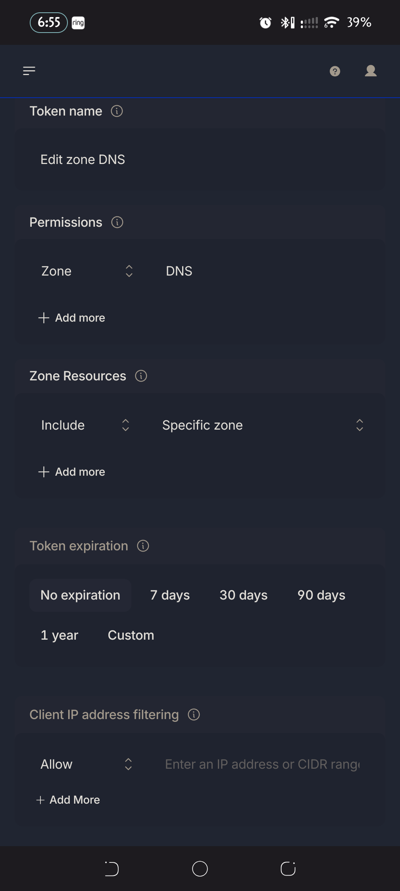
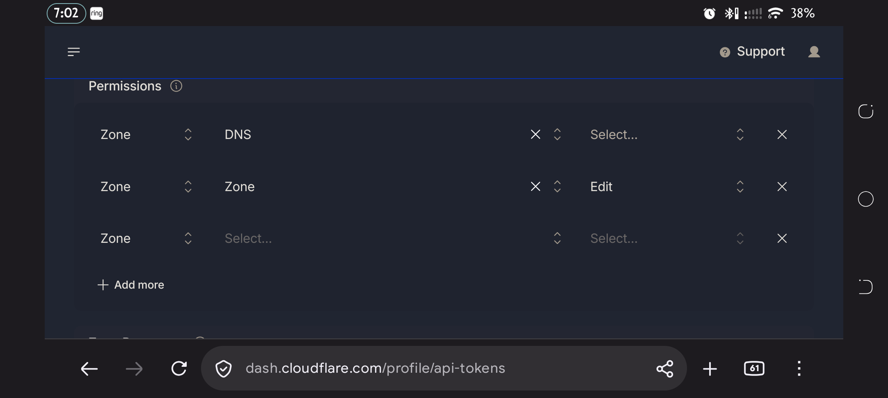
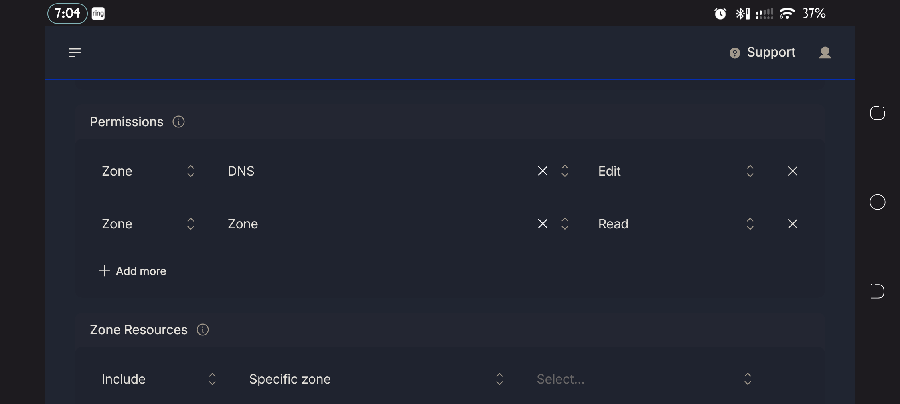
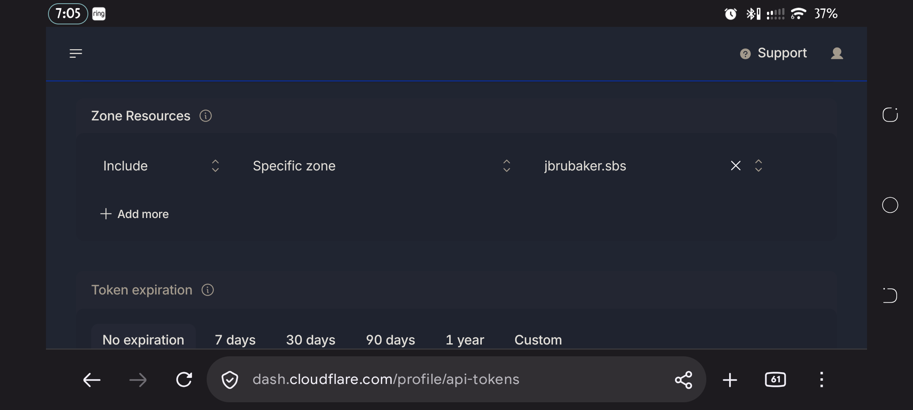

# Trusted, offline-capable HTTPS via Caddy + Let's Encrypt DNS-01 (design + setup doc)

> **Local network only.** Nothing here makes OpenSanctuary reachable from the
> internet. Do **not** forward any ports on the router. The internet is used
> for one thing: Caddy's outbound request to the Cloudflare API to get the
> certificate. Devices on the church network reach Caddy through a local DNS
> override, and the firewall rules below allow only local-network addresses.

_Last edited: 2026-11-03 14:21_

## Start here: get a valid certificate, step by step

You do **not** need a Cloudflare Tunnel (`cloudflared`) for this, and you
should not set one up: a Cloudflare Tunnel publishes your server to the
internet, which is the opposite of what we want. All Caddy needs from
Cloudflare is the ability to add one temporary DNS TXT record, which proves
to Let's Encrypt that you own the domain. That is a DNS-01 challenge, and it
is an outbound request from Caddy to Cloudflare's API. No inbound
connection, no port forwarding, no `A` record pointing at your church.

**What you need first:** a domain whose DNS is hosted on Cloudflare (a free
Cloudflare account is enough; add the domain and switch its nameservers to
Cloudflare if it isn't already), and a machine on the church network to run
OpenSanctuary and Caddy.

1. **Pick the name.** For example `connect.yourchurch.org`. You never create
   a public DNS record for it.
2. **Create a scoped Cloudflare API token.** Cloudflare dashboard → *My
   Profile* → *API Tokens* → *Create Token* → the *Edit zone DNS* template.
   The template does not finish the job for you; follow
   "Creating the Cloudflare API token" below, with screenshots. In short:
   two permission rows (`Zone · DNS · Edit` and `Zone · Zone · Read`), one
   specific zone, and copy the token right away because Cloudflare shows it
   only once. If Cloudflare is asking you to set up two-factor
   authentication first, do that first (see the same section).
3. **Run the setup script on the OpenSanctuary machine** (it installs Caddy
   with the Cloudflare plugin, writes the Caddyfile, registers the service
   and opens the firewall to the local network only). It asks for the token
   and never takes it as an argument.
   - Linux: `sudo packaging/setup-local-https-linux.sh --domain connect.yourchurch.org`
   - Windows (Administrator PowerShell):
     `.\packaging\setup-local-https-windows.ps1 -Domain connect.yourchurch.org`
   - Add `--dry-run` / `-DryRun` first to see every command without running it.
   - Or skip the terminal: in OpenSanctuary, open *Settings → Network → Public
     HTTPS URL → Set up automatically…*, enter the domain and token, and click
     **Run setup**. It runs this same script and shows its output live. Leave
     *Dry run* ticked the first time to see every step without changing
     anything. A real run asks for administrator permission: a polkit
     prompt on Linux, and the Windows UAC prompt on Windows. The .deb and
     `install.sh --system` install a polkit policy so the prompt says what
     it is for (other installs fall back to a generic polkit prompt). The Flatpak build can't ask, so use the terminal there.
4. **Add the local DNS override** in your router, Pi-hole or AdGuard:
   `connect.yourchurch.org` → the server's LAN IP. If the router has DNS
   rebinding protection, allow-list the domain. Details in "Critical
   prerequisite: offline local DNS" below. Without this, devices can't find
   the server by name.
5. **Tell OpenSanctuary.** *Settings → Network → Public HTTPS URL*, set it to
   `https://connect.yourchurch.org`. The badge next to the field turns green
   when the URL reaches this server.
6. **Check it.** From a phone on the church Wi-Fi, open
   `https://connect.yourchurch.org`. You should see a padlock and no
   warning. Watch certificate issuance with `journalctl -u caddy -f` on
   Linux. The full list is in "End-to-end verification checklist" at the
   bottom.

Caddy renews the certificate by itself, by default when 30 days (a third of
a 90-day certificate's life) remain. If
the internet is down at renewal time, it keeps serving the cached
certificate and retries later.

## Creating the Cloudflare API token

The screenshots below are from a real run on a phone. The layout is the same
on desktop.

### Before the token: two-factor authentication

Cloudflare may require two-factor authentication on the account before it lets
you create a token. At the end of that wizard it shows a page titled *Review
and save your two-factor authentication recovery codes* with eight one-time
codes and *Download / Print / Copy* buttons.

1. Save the codes in a password manager (*Copy* or *Download*), then click
   **Next** and finish the wizard.
2. Never screenshot or paste that page anywhere. If the codes were exposed,
   regenerate them from the two-factor section of your Cloudflare profile.

### The token form

*My Profile → API Tokens → Create Token → Edit zone DNS → Use template.* The
form has five parts: name, permissions, zone resources, expiration and client
IP filtering.



**Token name.** Anything works. Use something you will recognise later, such
as `caddy-acme-dns01`.

**Permissions: exactly two rows.** The template starts with one row whose
access level (the third dropdown) reads *Select...* and must be filled in.
The screenshot below shows the three mistakes people make: row 1 has no
access level, row 2 says *Edit* where it should say *Read*, and row 3 is an
empty row left over from *Add more*.



The finished list is:

| Scope | Resource | Access | Why Caddy needs it |
|---|---|---|---|
| Zone | DNS | **Edit** | create and delete the temporary `_acme-challenge` TXT record |
| Zone | Zone | **Read** | the Caddy plugin looks up the zone ID |



Do not give `Zone · Zone` *Edit*. It can change zone settings, and the token
does not need that. Delete the empty row with its **X**.

**Zone Resources.** *Include* → *Specific zone* → your domain. Never choose
*All zones*: a leaked token can then only touch this one domain. The token
covers every subdomain of that zone, so there is no need for one token per
subdomain.



**Token expiration.** *No expiration* is the simplest. If you choose a date,
set a calendar reminder: once the token expires Caddy can no longer renew, and
the site stops being trusted about 30 days later. One year is a reasonable
compromise.

**Client IP address filtering.** Leave blank unless the server has a fixed
public IP. DHCP and shared NAT make a filter easy to get wrong.

### Create it and keep it safe

1. Click **Continue to summary** and check it says *DNS:Edit* and *Zone:Read*
   for your one zone.
2. Click **Create Token** and copy the token immediately. If you lose it, use
   *Roll* on the token and update the service.
3. Verify it without printing it anywhere shared:

   ```bash
   curl -s -H "Authorization: Bearer $CLOUDFLARE_API_TOKEN" \
     https://api.cloudflare.com/client/v4/user/tokens/verify
   ```

   You want `"status":"active"`.
4. Store it in a password manager, and in the service's environment file
   (mode `600`), never in the Caddyfile, git, a chat or a screenshot. The
   setup script prompts for it so it never lands in shell history.

To rotate it, use *Roll* in the API Tokens list and update the environment
file. To revoke it, delete it there: Caddy keeps serving until the current
certificate expires, but cannot renew.

## Optional: a plain DNS record instead of a local override

The steps above use a local DNS override (router, Pi-hole or AdGuard) so no
public record exists and the building works with the internet down. A simpler
variant is to add a public record in Cloudflare:

| Field | Value |
|---|---|
| Type | `A` |
| Name | the subdomain, e.g. `connect` |
| IPv4 address | the server's LAN IP, e.g. `192.168.1.50` |
| Proxy status | **DNS only** (gray cloud) |

It must be *DNS only*: Cloudflare cannot proxy a private address. Issuance
works because Let's Encrypt only checks the TXT record, not your server.
Trade-offs against the local override:

- it only works on devices that can reach public DNS, so it fails when the
  internet is down;
- it publishes the server's private LAN IP;
- routers with DNS rebinding protection still need the domain allow-listed.

A wildcard record (`*`) lets one certificate cover `*.yourchurch.org` and
needs no new record per service.

Give the server a stable LAN address (a DHCP reservation on the router, or a
static IP in NetworkManager). If the address changes, the DNS record points at
the wrong machine.

## Trying it in a VM or container first

The prebuilt image
[CaddyBuilds/caddy-cloudflare](https://github.com/CaddyBuilds/caddy-cloudflare)
(`ghcr.io/caddybuilds/caddy-cloudflare:latest`) is stock Caddy with
`caddy-dns/cloudflare` compiled in, so you can test the token and Caddyfile
without building anything. Confirm the module with
`docker run --rm ghcr.io/caddybuilds/caddy-cloudflare:latest caddy list-modules | grep cloudflare`.

```yaml
services:
  caddy:
    image: ghcr.io/caddybuilds/caddy-cloudflare:latest
    restart: unless-stopped
    ports: ["80:80", "443:443"]
    env_file: cf.env            # CLOUDFLARE_API_TOKEN=..., mode 600
    volumes:
      - ./Caddyfile:/etc/caddy/Caddyfile
      - caddy_data:/data
      - caddy_config:/config
volumes: { caddy_data: , caddy_config: }
```

Test against Let's Encrypt **staging** first, so mistakes cost no rate-limit
budget. Add this to the Caddyfile's global block and remove it for
production:

```caddyfile
{
	acme_ca https://acme-staging-v02.api.letsencrypt.org/directory
}
```

Watch `docker logs -f` for `certificate obtained successfully`. A staging
certificate is untrusted by design, so use `curl -k` for that check only.
After switching to production, repeat without `-k`; it must succeed.

Put the token in the environment file without it touching shell history or a
chat window (it reads silently from the terminal):

```bash
read -rs t && printf 'CLOUDFLARE_API_TOKEN=%s\n' "$t" > cf.env && chmod 600 cf.env
```

Then check the certificate itself, not just that the page loads. The issuer
should be a Let's Encrypt (staging) intermediate and the subject your domain:

```bash
openssl s_client -connect connect.yourchurch.org:443 -servername connect.yourchurch.org </dev/null 2>/dev/null \
  | openssl x509 -noout -issuer -subject -dates
```

Clean up the test with `docker compose down -v`, remove the test DNS record
if you made one, and delete `cf.env`.

**VM caveat (passt networking).** A libvirt user-mode VM with the `passt`
backend gets the **same IP as the host** and only forwarded ports reach it.
A DNS name pointing at the host's LAN IP therefore reaches the host, not the
VM. Forward a port (for example `127.0.0.1:8443` to VM port `443`) and test
with `curl --resolve connect.yourchurch.org:8443:127.0.0.1
https://connect.yourchurch.org:8443`. Certificate issuance itself needs no
inbound connection, so it works regardless.

## Troubleshooting certificate issuance

| Symptom | Likely cause |
|---|---|
| `Invalid request headers`, or Cloudflare error 6003 / 9109 | wrong, truncated or newline-damaged token in the environment file |
| `Authentication error` (10000) | the token lacks *Zone · DNS · Edit*, or is scoped to a different zone |
| `could not determine zone` / `expected 1 zone, got 0` | missing *Zone · Zone · Read*, or the local DNS override is answering the challenge lookup (add `resolvers 1.1.1.1`) |
| `timed out waiting for record to fully propagate` | same resolver problem, or outbound DNS to `1.1.1.1` is blocked |
| `too many certificates` / rate limited | you went to production repeatedly; return to staging |
| browser still warns after production | cached staging certificate: clear Caddy's data volume and restart |

## What this gets you, and why it matters for OS-Next

Every HTTPS surface OS-Next has today — the "Secure Console," `pairing.html`
(camera access requires a secure context), and this session's Remote Console
Access feature — uses a **self-signed** certificate
(`get_or_create_tls_certificate`, `src/network/tls.rs`). That's fine for
reaching a console over loopback, but every non-loopback client (a
technician's phone scanning a pairing QR, an operator's laptop hitting the
printed remote-console link) sees a real "this connection is not private"
browser warning, or in some embedded/native contexts, a hard failure instead
of a click-through.

This doc describes running **[Caddy](https://caddyserver.com)** in front of
OS-Next as a reverse proxy, using the
[`caddy-dns/cloudflare`](https://github.com/caddy-dns/cloudflare) module to
get a real Let's Encrypt certificate via DNS-01 challenge instead of the
usual HTTP-01 challenge. The difference matters specifically for a church
network:

- **HTTP-01** (the default) requires port 80 reachable from the public
  internet at issuance/renewal time — i.e. a real port-forward and a
  connection that's up right then.
- **DNS-01** only requires the ability to create one TXT record via the
  Cloudflare API, which needs internet access but **not** an open inbound
  port and **not** a connection that happens to be up at exactly the right
  moment. Once issued, the certificate is cached on disk and Caddy keeps
  serving it — entirely offline — until it's within 30 days of expiring
  (Let's Encrypt certs are valid 90 days; Caddy renews automatically at that
  point). If the ISP connection is down when renewal is attempted, Caddy
  just keeps serving the still-valid cached cert and retries later — a
  church whose internet drops for a service doesn't lose HTTPS.

The result: `connect.yourchurch.org` resolves (via a local DNS override,
below) to the server's LAN IP, and every device on-site gets a real,
browser-trusted certificate with zero warnings — whether or not the
building's internet is currently working.

## How this fits into OS-Next's architecture

**Since this doc was first written, OS-Next's own network model changed**
(see `docs/update.md`'s history, or `src/main.rs`'s loopback-bind comment):
the cleartext plane is no longer an optional "disable it if you don't need
it" thing reachable from the LAN -- it's now *always* bound to `127.0.0.1`
only, and HTTPS (self-signed by default) is the only plane ever reachable
from the network. This actually makes the Caddy setup below simpler, not
harder: the cleartext plane was already something only a same-machine
process should ever talk to, and now that's enforced at the socket level
instead of by convention.

Caddy sits **in front of** OS-Next and reverse-proxies to its loopback-only
cleartext plane, exactly as before -- this still works unchanged because
Caddy runs on the *same machine*, and `127.0.0.1` is reachable by any local
process regardless of whether it's also reachable from the network:

```
Internet (only for cert issuance/renewal, every ~60-90 days)
      |
[Caddy :80/:443] --- real Let's Encrypt cert, terminates TLS here
      |
      | reverse_proxy 127.0.0.1:<server_port>   (OS-Next's loopback-only plane)
      v
[OS-Next :8080, bound to 127.0.0.1 only]   --- same app, same routes, unmodified
```

- Point Caddy's `reverse_proxy` at OS-Next's loopback plane (`8080` by
  default, `--port`/Settings-configured), not its HTTPS port (`8443`).
  Caddy is already doing the one real TLS termination; there's no reason to
  also terminate TLS a second time inside OS-Next for traffic that already
  arrived decrypted-then-re-encrypted-by-Caddy.
- OS-Next's own HTTPS plane (`:8443`, self-signed) can no longer be
  disabled, and doesn't need to be -- it's LAN-reachable but never
  exposed to the internet, so it coexists peacefully as a fallback (a self-signed
  cert warning, same as any device on the LAN gets without Caddy) alongside
  Caddy's real-cert public URL. There's nothing to turn off.
- **Do not forward any ports.** Keep OS-Next's own ports (`8080`, `8443`)
  and Caddy's `80`/`443` LAN-internal. `8080` can't be reached from the
  network at all now regardless. Caddy needs the internet only for the
  DNS-01 challenge's outbound API call to Cloudflare. No inbound connection
  from the internet is needed, unlike HTTP-01. The firewall rules in the
  setup steps allow only local-network source addresses.

### The reverse-proxy gap this setup exposed — fixed

`GET /api/internal/host-token` (`src/api/routes.rs`, the route that hands a
non-native console its `host_session_token` — see `docs/CLIENT_PAIRING.md`
"Console (host) authentication") decides whether to answer by checking the
request's real origin. It used to check only the request's *own TCP
connection* (`ConnectInfo<SocketAddr>` → `addr.ip().is_loopback()`) — the
only place in the backend that made a security decision this way (verified
by grepping the whole `src/` tree for `is_loopback`).

**Running Caddy in front of OS-Next on the same machine** (`reverse_proxy
127.0.0.1:8080`) means every request Caddy forwards arrives at OS-Next
*from* `127.0.0.1` — because that's genuinely who opened the TCP connection
to OS-Next's listener; Caddy did, on the app's own loopback interface. Left
unfixed, **every visitor in the world would look like a loopback caller**,
because Caddy sits between OS-Next and the network. That would have
silently defeated the entire point of the loopback check: an attacker on
the internet could have hit `https://connect.yourchurch.org/api/internal/host-token`
and gotten the real host token handed back, no different from a real
operator sitting at the machine.

**Fixed** in `src/network/mod.rs::resolve_real_client_ip` — the standard
"trusted proxy" pattern (the same idea as nginx's
`set_real_ip_from`/`real_ip_header`, or Rails'
`config.action_dispatch.trusted_proxies`): only trust an `X-Forwarded-For`
header's client-IP value when the *immediate* TCP peer is itself loopback
(i.e. the request genuinely arrived via something running on this same
machine), and in that case treat *that* address, not `127.0.0.1`, as the
real caller for the loopback check. A request whose immediate peer is
**not** loopback gets no such override — nobody off-machine can spoof this
by just adding their own `X-Forwarded-For` header, because their own TCP
connection was never loopback to begin with. `get_internal_host_token` now
calls this before its loopback check; no config flag needed — a bare TCP
loopback connection with no forwarding header (native webview, or a browser
tab hitting `127.0.0.1` directly, with no proxy involved) behaves exactly as
it did before.

Verified three ways: a pure-function unit test
(`network::tests::test_resolve_real_client_ip_trusts_forwarded_header_only_from_loopback`)
covering the forged-header/multi-hop/garbage-header cases; a real-server
integration test extending `test_client_pairing_lifecycle_and_zero_auth_displays`
that hits the actual route over a real loopback TCP connection with a
spoofed `X-Forwarded-For: 203.0.113.7` and confirms `403 Forbidden`, then
confirms `X-Forwarded-For: 127.0.0.1` still succeeds; and a live `curl`
check against the real release binary reproducing the exact scenario this
section describes:

```
$ curl -o /dev/null -w '%{http_code}\n' http://127.0.0.1:PORT/api/internal/host-token
200   # direct loopback, no proxy -- unaffected
$ curl -o /dev/null -w '%{http_code}\n' -H 'X-Forwarded-For: 203.0.113.7' http://127.0.0.1:PORT/api/internal/host-token
403   # a proxy reporting a real remote client -- correctly rejected
$ curl -o /dev/null -w '%{http_code}\n' -H 'X-Forwarded-For: 127.0.0.1' http://127.0.0.1:PORT/api/internal/host-token
200   # a proxy reporting a loopback original client -- still allowed
```

Caddy in front of OS-Next is now safe to run as described in this doc — no
extra firewalling of `/api/internal/host-token` beyond the normal "forward nothing,
LAN-only firewall" guidance above is required.

### Public HTTPS URL — preferring the trusted domain everywhere

Once a church has `connect.yourchurch.org` set up, **Settings > Network >
Public HTTPS URL** lets every place in the app that would otherwise fall
back to the self-signed cert (and warn the user about it) prefer the
trusted public domain instead:

- The **Remote Console Access** banner/QR printed at startup (`src/main.rs`)
  prints `https://connect.yourchurch.org/#host_token=...` as the primary
  line/QR once the setting is non-empty, with the self-signed
  `https://<lan-ip>:<https-port>/#host_token=...` URL still printed
  underneath as a fallback — it's never silently dropped, since the public
  URL depends on external DNS/Caddy actually being up, which the banner has
  no way to verify at boot.
- `presentation_helpers.ts`'s `buildPairingUrl`/`buildRemoteUrl` (the TV/Roku
  pairing bridge and Mobile Remote QR) prefer the configured public URL over
  the self-signed `https_port` plane — for `pairing.html` specifically, a
  trusted cert removes any ambiguity around camera-API secure-context
  requirements on stricter mobile browsers.
- `GET /api/network/info`'s `pairing_url`/`remote_url` prefer it too, and
  the response carries the raw value back as `public_https_url` for any
  client that wants it directly.

**Setting it**: paste the `https://` URL into Settings > Network > Public
HTTPS URL. A live badge next to the field verifies it end-to-end as you
type (debounced) — it's not just "looks like a URL," it actually calls `GET
/api/network/check-public-url` server-side, which fetches
`{url}/api/server-info` and confirms the `instance_id` that comes back
matches *this* server, not just that some HTTPS server answered. That
catches the easy mistakes (DNS not propagated yet, Caddy not running, or
the domain accidentally pointing at a different machine) before you rely on
it. Saving an invalid value (wrong scheme, no host) is rejected server-side
too, same as the hostname/port conflict checks above it.

## Critical prerequisite: offline local DNS

When the building's internet is down, phones and laptops can't query public
DNS (`1.1.1.1`, `8.8.8.8`) to resolve `connect.yourchurch.org` at all —
they need to get that answer from something on the LAN:

- In the church's router (or an internal DNS server like Pi-hole/AdGuard),
  add a local DNS override: `connect.yourchurch.org` → the server's LAN IP
  (e.g. `192.168.1.50`).
- If the router has **DNS rebinding protection** enabled (many consumer
  routers do, by default, as an anti-malware measure), it will otherwise
  refuse to let a public domain name resolve to a private IP — add
  `yourchurch.org` to its allow-list.

Without this, Caddy's certificate is real and trusted, but nothing on-site
can find the server by name once the internet is out — the local DNS
override is what makes this actually offline-capable, not just "has a real
cert."

## The Caddyfile

Standard Caddy builds don't include the Cloudflare DNS module — you need a
build compiled with `github.com/caddy-dns/cloudflare` (see the
platform-specific install steps below). Point it at OS-Next's cleartext
port:

```caddyfile
connect.yourchurch.org {
    tls {
        dns cloudflare {env.CLOUDFLARE_API_TOKEN}
        resolvers 1.1.1.1
    }

    reverse_proxy localhost:8080
}
```

`resolvers 1.1.1.1` makes Caddy check the DNS challenge against a public
resolver instead of the machine's own. This matters here: once your router
or Pi-hole overrides `connect.yourchurch.org` to a LAN IP, the server's own
resolver can answer wrongly during the challenge and fail with errors such as
`expected 1 zone, got 0` or `timed out waiting for record to fully
propagate`. (That does need outbound access to `1.1.1.1`. Use another public
resolver if your network blocks it.)

Prefer an environment variable (`{env.CLOUDFLARE_API_TOKEN}`, set in the
service definition below) over pasting the token directly into the
Caddyfile — the token only needs the Cloudflare **Zone · DNS · Edit** and **Zone · Zone · Read** permissions
scoped to this one zone, not full account access; create it as its own
scoped API token in the Cloudflare dashboard, not your global API key.

## Setup for Windows (Home Edition)

Windows Home has no built-in way to run a standalone `.exe` as a persistent
background service — [NSSM](https://nssm.cc) (Non-Sucking Service Manager)
fills that gap.

### Quickest path: run the script

`packaging/setup-local-https-windows.ps1` automates everything below — Caddy
download, Caddyfile, the NSSM service, and the firewall rules — in one
command, from an **Administrator PowerShell**:

```powershell
.\packaging\setup-local-https-windows.ps1 -Domain connect.yourchurch.org
```

It prompts for the Cloudflare API token securely (never a command-line
argument, so it never lands in PowerShell history). Pass `-DryRun` first if
you want to see exactly what it would do without changing anything — every
command it would run gets printed either way. It's safe to re-run: an
existing install just gets its Caddyfile/token updated and the service
restarted, instead of failing.

It also checks 80/443 for a port collision before doing anything else
(the most common reason this kind of setup fails — IIS, a stray previous
Caddy, etc.) and, if its own `New-NetFirewallRule` step fails for any reason,
prints the exact manual firewall commands from step 2 below directly in its
output — you're never stuck without an answer.

What it does **not** automate: the local DNS override ("Critical
prerequisite" above) and setting Public HTTPS URL in OS-Next itself once
Caddy is up — both still require a manual step.

The manual steps it automates are documented next, for anyone who'd rather
do this by hand, review exactly what the script does before running it, or
fix a step the script couldn't finish on its own.

### 1. Download Caddy with the Cloudflare plugin

Go to the [Caddy download page](https://caddyserver.com/download), add
`github.com/caddy-dns/cloudflare` under "Plugins," and download the Windows
(amd64) build.

- Place `caddy.exe` in a permanent directory, e.g. `C:\Caddy\caddy.exe`.
- Place the Caddyfile alongside it: `C:\Caddy\Caddyfile` (use
  `root * C:/ChurchSite` / Windows-style paths if serving static files
  instead of/alongside `reverse_proxy`).

### 2. Open the firewall for the local network only

In an Administrator PowerShell (`-RemoteAddress LocalSubnet` keeps the rules
from matching anything outside the machine's own subnet):

```powershell
New-NetFirewallRule -DisplayName "Caddy-HTTP" -Direction Inbound -LocalPort 80 -Protocol TCP -RemoteAddress LocalSubnet -Action Allow
New-NetFirewallRule -DisplayName "Caddy-HTTPS" -Direction Inbound -LocalPort 443 -Protocol TCP -RemoteAddress LocalSubnet -Action Allow
```

### 3. Install and run Caddy as a background service

```powershell
# Install NSSM (or download manually from nssm.cc if winget can't find it)
winget install -e --id NSSM.NSSM --accept-source-agreements --accept-package-agreements

# Register Caddy as a service, with the Cloudflare token as an env var
nssm install Caddy "C:\Caddy\caddy.exe" "run --config C:\Caddy\Caddyfile"
nssm set Caddy AppEnvironmentExtra "CLOUDFLARE_API_TOKEN=your-scoped-token-here"
nssm set Caddy Start SERVICE_AUTO_START
nssm start Caddy
```

**Verification:** `Get-Service Caddy` should report `Running`. Caddy now
starts silently on boot, even with no user logged in. Check
`C:\Caddy\Caddyfile`-relative logs, or run `nssm status Caddy`, if the
service doesn't come up — the most common cause is the Cloudflare token
lacking DNS-edit permission on the zone.

## Setup for Linux (Debian, Ubuntu, Arch, RHEL)

On Linux, Caddy runs as a native `systemd` unit with automatic permission
dropping.

### Quickest path: run the script

`packaging/setup-local-https-linux.sh` automates everything below — Caddy
download, Caddyfile, the systemd service, and the firewall rules — in one
command (needs root for binding 80/443, systemd, and the firewall):

```bash
sudo packaging/setup-local-https-linux.sh --domain connect.yourchurch.org
```

It prompts for the Cloudflare API token securely (never a command-line
argument, so it never lands in shell history or `ps`). Pass `--dry-run`
first if you want to see exactly what it would do without changing
anything — every command it would run gets printed either way. It's safe
to re-run: an existing install just gets its Caddyfile/token updated and
reloaded, instead of failing.

It also checks 80/443 for a port collision before doing anything else
(the most common reason this kind of setup fails — Apache, a stray
previous Caddy instance, etc.) and, if its own `ufw`/`firewall-cmd` step
fails or neither tool is found, prints the exact manual firewall commands
from step 2 below directly in its output — you're never stuck without an
answer.

What it does **not** automate: the local DNS override ("Critical
prerequisite" above) and setting Public HTTPS URL in OS-Next itself once
Caddy is up — both still require a manual step.

The manual steps it automates are documented next, for anyone who'd rather
do this by hand, review exactly what the script does before running it, or
fix a step the script couldn't finish on its own.

### 1. Get a Caddy build with the Cloudflare plugin

Simplest: download a prebuilt custom binary from the
[Caddy download page](https://caddyserver.com/download) the same way as the
Windows steps above, with `github.com/caddy-dns/cloudflare` added, then:

```bash
sudo mv caddy_custom_linux_amd64 /usr/bin/caddy
sudo chmod +x /usr/bin/caddy
```

Alternative, if you'd rather build it yourself with `xcaddy` (Debian/Ubuntu):

```bash
sudo apt install -y debian-keyring debian-archive-keyring apt-transport-https curl
curl -1sLf 'https://dl.cloudsmith.io/public/caddy/xcaddy/gpg.key' | sudo gpg --dearmor -o /usr/share/keyrings/caddy-xcaddy-archive-keyring.gpg
curl -1sLf 'https://dl.cloudsmith.io/public/caddy/xcaddy/debian.deb.txt' | sudo tee /etc/apt/sources.list.d/caddy-xcaddy.list
sudo apt update && sudo apt install -y xcaddy

sudo xcaddy build --with github.com/caddy-dns/cloudflare --output /usr/bin/caddy
```

(On Arch/RHEL without that apt repo, install `go` and run `go install
github.com/caddyserver/xcaddy/cmd/xcaddy@latest` instead, then the same
`xcaddy build` command.)

### 2. Open the firewall for the local network only

Allow only private (LAN) source addresses:

```bash
# UFW (Debian/Ubuntu)
for net in 10.0.0.0/8 172.16.0.0/12 192.168.0.0/16; do
  sudo ufw allow from $net to any port 80,443 proto tcp
done

# firewalld (RHEL/Fedora)
for net in 10.0.0.0/8 172.16.0.0/12 192.168.0.0/16; do
  sudo firewall-cmd --permanent --add-rich-rule="rule family=ipv4 source address=$net port port=80 protocol=tcp accept"
  sudo firewall-cmd --permanent --add-rich-rule="rule family=ipv4 source address=$net port port=443 protocol=tcp accept"
done
sudo firewall-cmd --reload
```

### 3. Configuration and service

```bash
sudo mkdir -p /etc/caddy
sudo nano /etc/caddy/Caddyfile   # paste the Caddyfile above
```

```bash
sudo useradd --system --shell /bin/false --create-home caddy || true
sudo curl -sSL https://raw.githubusercontent.com/caddyserver/dist/master/init/caddy.service -o /etc/systemd/system/caddy.service

# The Cloudflare token needs to reach Caddy's environment -- add an
# override rather than editing the fetched unit file directly, so a future
# re-fetch of caddy.service doesn't silently drop it:
sudo mkdir -p /etc/systemd/system/caddy.service.d
printf '[Service]\nEnvironment=CLOUDFLARE_API_TOKEN=your-scoped-token-here\n' | sudo tee /etc/systemd/system/caddy.service.d/override.conf

sudo systemctl daemon-reload
sudo systemctl enable --now caddy
```

**Verification:** `sudo systemctl status caddy` should report `active
(running)`. Watch certificate issuance in real time with `journalctl -u
caddy -f` on first start — a successful DNS-01 issuance logs the TXT record
being created and verified, then "certificate obtained successfully."

## End-to-end verification checklist

- [ ] `connect.yourchurch.org` resolves to the server's LAN IP from a device
      on the church Wi-Fi, both with internet up and with the WAN link
      unplugged (proves the local DNS override actually works offline).
- [ ] Opening `https://connect.yourchurch.org` shows a padlock with no
      warning, on a phone that has never visited this server before.
- [ ] `journalctl -u caddy -e` (Linux) / the NSSM-managed service log
      (Windows) shows a successful certificate issuance, and again ~60-90
      days later shows a renewal, without anyone doing anything.
- [ ] With the WAN link unplugged, existing HTTPS access keeps working
      until the cached certificate's actual expiry — confirming this is
      genuinely offline-capable, not just "worked once while online."
